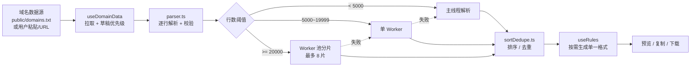
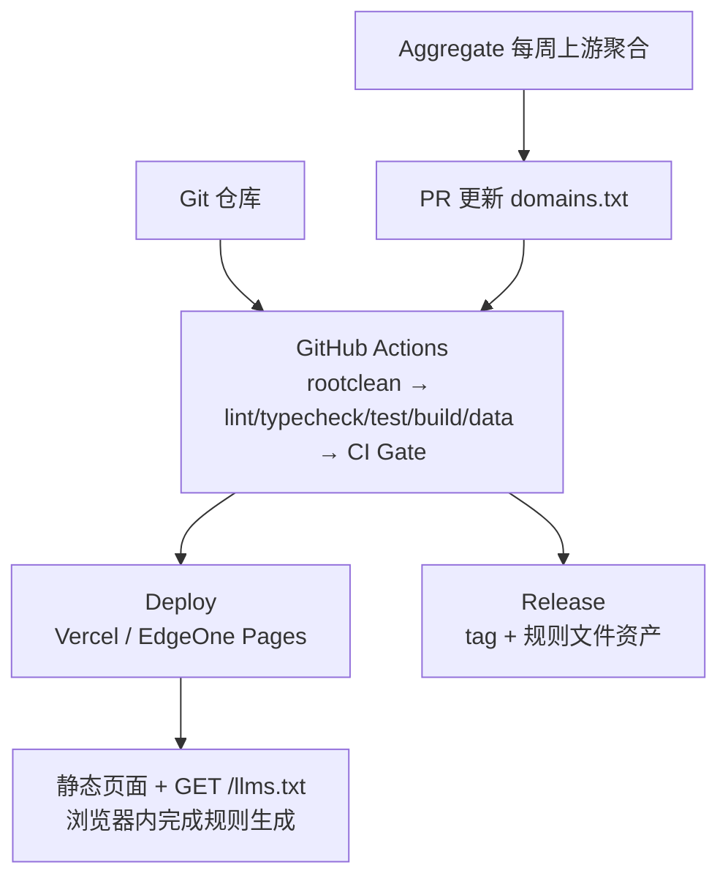

# 01 项目概述

> 最后审查：2026-11-27（与 package.json v3.22.5 对齐） · 文档集版本：v3.22.5
> 权威级别：权威说明 · 事实源：`package.json`、`src/config/version.ts`、`docs/SPEC.md`；数字以脚本实算为准（见 [文档中心 §4](./README.md#4-版本控制)）。

## 目录

- [1. 背景与问题](#1-背景与问题)
- [2. 产品目标与非目标](#2-产品目标与非目标)
- [3. 技术栈与选型理由](#3-技术栈与选型理由)
- [4. 架构设计](#4-架构设计)
- [5. 当前已知限制](#5-当前已知限制)

## 1. 背景与问题

网页、视频与 App 广告依赖域名解析完成资源加载。在单台设备上装插件只能保护该设备，且移动端与 IoT 设备往往无法安装。DNS 层拦截在**域名解析阶段**切断请求，路由器配置一次即可覆盖全屋设备。

DNS Shield 解决三个具体问题：

1. **规则制作门槛**：不同路由器 / DNS 软件要求不同语法（dnsmasq、hosts、AdGuard、RPZ 等），手工改写易错。
2. **数据源分散**：上游广告列表格式不一，缺乏统一维护与派生机制。
3. **隐私与可控性**：用户不希望把自定义清单上传到陌生服务器，也不希望规则生成依赖后端可用性。

## 2. 产品目标与非目标

### 2.1 目标

| 目标 | 衡量方式 |
|------|----------|
| 在路由器 / DNS 服务配置一次，全屋设备生效 | 支持 12 种输出格式，覆盖 Merlin / OpenWrt / 小米 / AdGuard Home / Pi-hole 等 |
| 域名清单在浏览器本地处理 | 网络请求仅用于拉取预设清单；无账号体系、无用户输入上传接口 |
| 单一数据源派生所有产物 | `public/domains.txt` 是唯一事实来源，其余 11 个文件由 `scripts/gen-format-files.mjs` 生成 |
| 大清单可用 | ≥20000 行按行边界分片、最多 8 个 Worker 并行；失败逐级回退 |
| 多语言、可访问 | 16 语言，`<html lang>` / `dir` 首屏同步，WCAG AA 对比度 |

### 2.2 非目标

- 不提供账号、云数据库、跨设备同步；草稿只存在用户本地。
- 不是通用 DNS 服务器，也不接管递归解析；产物需部署到用户自有路由器 / DNS 软件。
- 不保证 100% 拦截率；广告域名持续变化，需定期更新（见 [06 FAQ](./06-faq-troubleshooting.md)）。

## 3. 技术栈与选型理由

| 层次 | 选型 | 选型理由 | 版本 / 约束 |
|------|------|----------|-------------|
| 框架 | Next.js App Router | 静态预渲染 + Route Handler 覆盖 Vercel / EdgeOne；SEO 元数据与 `llms.txt` 可构建期生成 | `^14.2.25` |
| UI | React + TypeScript strict | 组件化与类型安全；`tsc --noEmit` 为 CI 门禁 | React `^18`，TS 5 |
| 样式 | Tailwind CSS + shadcn/ui（Radix） | 原子类与可访问原语；避免自研弹窗 / 下拉的无障碍缺陷 | Tailwind 3.4 |
| 通知 | sonner | 统一 toast，减少自研状态 | `sonner` |
| 计算 | Web Worker + 主线程回退 | 大文本解析不阻塞 UI；Worker 不可用时功能不降级消失 | 5000 行单 Worker / 20000 行分片池 |
| 测试 | Vitest + jsdom + v8 coverage | 纯函数与 hooks 均可测；覆盖率门禁 80/75/85/80 | 显式 `all: false` 口径 |
| 包管理 | npm | `package-lock.json` 保证可复现安装 | npm ≥ 11 |
| 运行时 | Node 24 | 与 CI / Vercel 对齐，传递依赖要求 ≥24.15.0 | `>=24.15.0 <25` |

> 版本事实以 `package.json` 为准。历史冻结文档（如 `CHANGELOG.md` 旧小节、`docs/AUDIT-REPORT-v3.19.0.md`）中的旧依赖表述按冻结约定保留；活跃文档若出现与依赖不一致的措辞，须先在 [任务清单](./tasks.md) 登记再修正，不在本文档复述。

## 4. 架构设计

### 4.1 分层职责

| 目录 | 职责 | 关键入口 |
|------|------|----------|
| `src/app/` | 路由、布局、SEO / 静态资源端点 | `layout.tsx`（首屏 lang/dir/theme 脚本）、`page.tsx` → `Home.tsx`、`about/page.tsx`、`llms.txt/route.ts`、`(seo)/site-meta.ts` |
| `src/components/` | 业务组件与 `ui/` 基础组件 | `InputPanel.tsx`、`OutputPanel.tsx`、`Header.tsx`、`SeoContent.tsx`、`ServiceWorkerRegistrar.tsx`、`SettingsLanguage.tsx` |
| `src/hooks/` | 状态编排与副作用 | `useHomeController.ts`、`useDomainData.ts`、`useRules.ts`、`useWorkerPool.ts`、`useAutosave.ts` |
| `src/utils/` | 纯函数与边界处理 | `parser.ts`、`rulesGenerator.ts`、`sortDedupe.ts`、`fileUtils.ts`、`domainFetch.ts`、`fetchGuards.ts`、`iterateLines.ts` |
| `src/workers/` | 后台解析 | `parseShard.worker.ts`、`ruleProcessor.worker.ts` |
| `src/config/` `src/types/` | 配置、站点事实与类型契约 | `config/index.ts`、`seo-content.ts`、`site.ts`、`languages.ts`、`types/formats.ts` |
| `src/context/` `src/locales/` | 全局 Context 与 16 语翻译 | `AppContext.tsx`、`locales/zh-cn.json`（回退基准） |
| `src/app/globals.css` / `src/styles/` | 全局样式入口与按职责拆分的 8 个样式模块 | `src/app/globals.css`（Tailwind 指令与 design tokens）、`src/styles/layout.css`、`hero.css`、`output.css`、`seo.css` 等 |
| `src/test-utils/` | 测试装置 | `renderHook.ts`、`domainDataTestKit.ts` 等 |
| `scripts/` | 数据派生与文档校验 | `gen-format-files.mjs`、`sync-facts.mjs`、`check-locales.mjs` |

### 4.2 总体数据流

关键设计点：

- **草稿优先**：本地草稿无条件恢复；远端清单加载完成后若发现草稿已恢复，则放弃远端内容，避免用户编辑被覆盖。
- **单飞**：解析任务按 `task + '\0' + text` 复用，池引用稳定，避免重复 `postMessage` 克隆大文本。
- **按需生成**：同一时刻只生成一个目标格式，不预生成 12 份，降低大输入内存占用。
- **分级回退**：并行分片 → 单 Worker → 主线程，任一环节失败仍有可用结果。
- **本地持久化**：30 秒自动保存，IndexedDB（50MB）优先、localStorage（5MB）兜底。

### 4.3 部署与运行时边界

运行时没有业务后端：HTTP 层只提供页面、静态规则文件与少量元数据端点（详见 [04 API](./04-api.md)）。安全边界集中在 `next.config.js` 的安全响应头（单一来源）、`fileUtils.ts` 的 URL 协议 / 体积校验与文件名净化、`domainFetch.ts` 的流式限量。

## 5. 当前已知限制

> 状态基线：v3.22.5 · 2026-11-27；未完成任务 **0 项**（唯一来源 [docs/tasks.md](./tasks.md) §二）。本节只列当前真实边界，不维护任务状态。

以下限制经代码核实；状态看 [任务清单](./tasks.md)，方案看 [07 优化建议](./07-improvements.md)，历史冻结文档不在此复述：

- `.npmrc` 已恢复并启用 `engine-strict=true`；`package-lock.json` 为唯一锁文件（`pnpm-lock.yaml` 已删除，统一 npm 管理）。Node ≥24.15.0 / npm ≥11 已完成实机安装与全链路验证（T-COMPAT-01 已归档，详见 [tasks-done.md §十二](./tasks-done.md)）。
- 生产环境由 `ServiceWorkerRegistrar` 注册同源 Service Worker（dev 不注册）；离线缓存白名单已实现，断网回归实测仍待执行（原 O-06 注册项已归档）。
- `public/category-index.txt` 已纳入 aggregate / release / CI 清单，线上分类筛选的 404 降级风险已消除（T-REL-01 已归档）。
- 生产 CSP 的 `script-src` 仍包含 `'unsafe-inline'`（首屏内联脚本所需），Trusted Types 未启用；评估结论为「暂不启用，待 staging + Report-Only 条件」，证据见 [CSP 评估](./05-security-assessment-csp.md)（T-SEC-01 / O-08 已归档）。
- `parser.ts` / `sortDedupe.ts` 均已改用 `iterateLines.ts` 逐行迭代，`parseAggregate.ts` 的分片改为换行边界扫描且 `push(...arr)` 已改逐项 push；50MB 基准实测峰值约 1.0× 文本（阈值 1.5×），已纳入 `npm run benchmark:large`（T-PERF-01 / O-01 已归档）。
- 测试实测 **61 套件 / 381 用例全绿**（2026-11-26 `npm test` 实跑），旧记录 59/376、57/364、54/349 均为历史快照。
