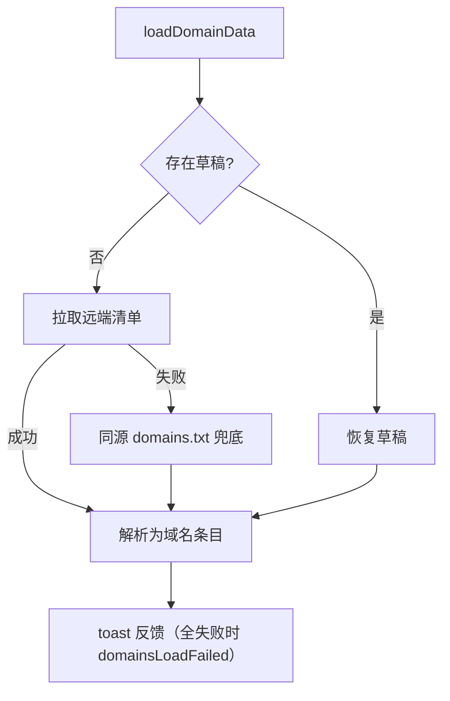
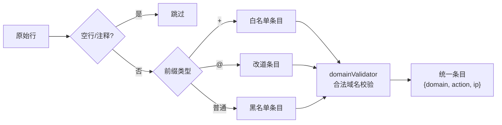

# 03 功能模块说明

> 文档集版本：v3.22.2 · 最后审查：2026-11-26 · 适用产品版本：v3.22.2
> 实现为准：本文描述的行为均可在 `src/` 对应文件中复核；约束级规则见 [SPEC](./SPEC.md)。

## 1. 模块总览

| 编号 | 模块 | 用户价值 | 主要实现 |
|------|------|----------|----------|
| M1 | 数据源与导入 | 预设清单、URL、粘贴三种输入 | `useDomainData.ts`、`domainFetch.ts`、`fileUtils.ts` |
| M2 | 解析引擎 | 任意格式 → 统一域名条目 | `parser.ts`、`domainValidator.ts`、`domainPrimitives.ts` |
| M3 | 并行调度 | 大清单快速解析且不卡 UI | `useRuleWorker.ts`、`useWorkerPool.ts`、`parseAggregate.ts` |
| M4 | 规则生成 | 12 种目标格式与头部注释 | `rulesGenerator.ts`、`headerConfigs.ts`、`formatGenerators.ts` |
| M5 | 输出与交付 | 预览、复制、下载、脚本生成 | `OutputPanel.tsx`、`OutputPreview.tsx`、`scriptGenerators.ts` |
| M6 | 设置与持久化 | 项目信息、IP、外观、草稿恢复 | `useSettings.ts`、`useAutosave.ts`、`autosaveStorage.ts` |
| M7 | 规则测试器 | 输入域名即时看命中层级 | `RuleTesterModal.tsx`、`ruleMatcher.ts` |
| M8 | 多语言与 SEO | 16 语界面、结构化数据、`llms.txt` | `useLanguage.ts`、`locales/`、`json-ld.ts`、`seo-content.ts` |
| M9 | 产物构建与门禁 | 单一数据源派生 11 文件、CI 校验 | `scripts/gen-format-files.mjs`、`scripts/check-locales.mjs` |

## 2. M1 数据源与导入

### 2.1 输入来源与优先级

1. **本地草稿**：存在 IndexedDB / localStorage 的用户编辑内容，优先级最高。
2. **预设清单**：`public/domains.txt`（唯一事实来源），远端拉取失败时回退同源静态文件。
3. **URL 导入**：用户提供的 http/https URL，单响应 10MB、批量 50MB、每批最多 5 个 URL。
4. **手动粘贴**：`source-editor` 输入框，支持与预设合并或替换。



### 2.2 关键逻辑

- **草稿优先**：草稿守卫必须在 `await` 之后再次确认；远端加载完成时检测到草稿已恢复即放弃远端内容（防止数据丢失）。
- **URL 校验**：协议白名单 http/https、URL 长度 ≤2048；非流式环境按 UTF-8 实际字节数限量，超限主动取消读取。
- **文件名净化**：下载名去除路径分隔符与非法字符，防止路径穿越。

## 3. M2 解析引擎

### 3.1 输入行语法

| 前缀 / 形式 | 含义 | 输出示例（dnsmasq） |
|-------------|------|---------------------|
| `example.com` | 黑名单 | `address=/example.com/0.0.0.0` |
| `+example.com` | 白名单（放行） | `server=/example.com/` 或 `@@\|\|example.com^` |
| `@example.com=1.2.3.4` | 自定义解析 | `address=/example.com/1.2.3.4` |
| `# ...` | 注释 | 头部注释或忽略 |

### 3.2 解析流程



关键实现：`src/utils/parseLine.ts` 的 `parseDomainLine` 先识别正则前缀再剥离内联注释，避免 `/\d+#/` 被截断；AdGuard 的 `||` 边界需避免空数组 `Math.min` 造成 `Infinity` 切片。

## 4. M3 并行调度

| 输入规模 | 路径 | 实现 |
|----------|------|------|
| < 5000 行 | 主线程 | `useAsyncRuleProcessing` 同步解析 |
| 5000–19999 行 | 单 Worker | `useRuleWorker` |
| ≥ 20000 行 | 最多 8 个 Worker 分片 | `splitIntoShards`（按行边界）→ `useWorkerPool` |

回退链：并行失败 → 单 Worker → 主线程，每层失败都有用户可见提示，不会静默返回空结果。

**单飞机制**：任务键 `task + '\0' + text`，相同输入复用同一 Promise；Worker 池引用用 `useMemo` 稳定，避免引用抖动导致 `loadDomainData` 每帧重入（曾引发内存暴涨，见 [07 优化建议](./07-improvements.md) O-01）。

## 5. M4 规则生成

- **按需生成**：`useRules` 只为当前选中格式调用 `generateRules`，不预生成全部 12 种。
- **头部注释契约**：头部每一行（含「使用方法」）必须以该格式注释符开头：`#`（多数）、`!`（AdGuard）、`;`（BIND RPZ）；否则路由器 / DNS 软件会拒绝加载。
- **白名单生效**：黑名单生成时剔除白名单域名；AdGuard 白名单另写 `whitelist.txt`（`@@||domain^`）。
- **设置联动**：IP、项目名、去通配 / 去重开关、界面语言变更后重新生成预览与导出，避免口径不一致。

## 6. M5 输出与交付

- **预览**：`OutputPreview` 使用虚拟列表（阈值 500 行，行高 24px），避免大清单渲染数千 DOM 节点。
- **行数统计**：`countLines` 非分配计数；行数未变化时跳过行号重绘（WeakMap 缓存）。
- **复制 / 下载**：`fileUtils` 生成 Blob 与净化后的文件名；下载名包含格式与版本。
- **路由同步脚本**：`scriptGenerators.ts` 生成 OpenWrt / Merlin / Padavan / SmartDNS / Pi-hole 定时更新脚本。

## 7. M6 设置与持久化

| 设置项 | 存储位置 | 说明 |
|--------|----------|------|
| 语言 / 主题 | localStorage | 首屏内联脚本按 localStorage 恢复，避免闪变 |
| 项目名 / 版本头 / IPv4 / IPv6 | localStorage（设置面板） | 影响导出头部注释 |
| 去通配 / 去重开关 | localStorage | 影响生成结果 |
| 草稿 | IndexedDB（50MB）→ localStorage（5MB） | 30 秒自动保存；用户显式清空才删除 |

## 8. M7 规则测试器

输入域名后按「白名单 → 改道 → 黑名单 → 直连」顺序返回命中层级与最终解析行为；用于验证复杂规则优先级。详细操作步骤见 [05 用户操作指南](./05-user-guide.md) §6。

## 9. M8 多语言与 SEO

- 16 语言，`zh-cn` 为回退基准；语言优先级 `zh-cn > zh-tw > en`。
- `<html lang>` 与 `dir` 在首屏脚本与运行时双重同步；阿拉伯语为 RTL。
- SEO 端点：`robots.txt`、`sitemap.xml`、`llms.txt`，结构化数据按页面归属注入（主页 / 关于页分离）。

## 10. M9 产物构建与门禁

```bash
node scripts/gen-format-files.mjs   # 从 domains.txt 派生 11 个格式文件
node scripts/count-domains.mjs      # 实算域名数（2026-11-26 实算 127188，以脚本输出为准）
node scripts/check-locales.mjs      # 16 语键一致性（214 键）
node scripts/sync-facts.mjs --check # 版本展示位（13 处）
node scripts/check-root-clean.mjs   # 根目录洁净度
```

以上脚本均由 CI 调用；任一失败阻断合入。详细说明见 [02 安装与部署](../DEPLOYMENT.md) §CI/CD。
