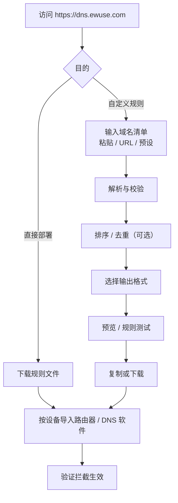
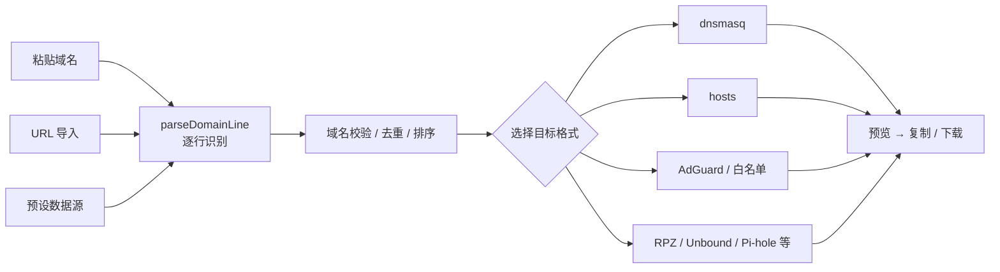
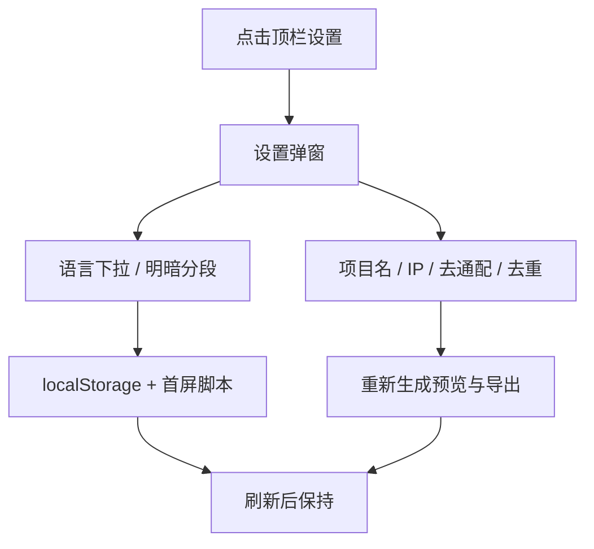

# 05 用户操作指南

> 文档集版本：v3.22.2 · 最后审查：2026-11-26 · 适用产品版本：v3.22.2
> 面向：终端用户、在线工具使用者、站点部署者。术语见 [文档中心 §3](./README.md#3-术语表全文统一用词)。

## 目录

- [1. 角色与权限](#1-角色与权限)
- [2. 端到端使用流程](#2-端到端使用流程)
- [3. 首次使用：下载并部署规则](#3-首次使用下载并部署规则)
- [4. 自定义清单与格式转换](#4-自定义清单与格式转换)
- [5. 规则测试器](#5-规则测试器)
- [6. 设置与本地存储](#6-设置与本地存储)
- [7. 部署者与开发者操作要点](#7-部署者与开发者操作要点)
- [8. 常见操作误区](#8-常见操作误区)

## 1. 角色与权限

DNS Shield **没有账号体系、没有应用内角色权限**。所有页面公开访问，用户输入只在本地浏览器处理。下表是「职责角色」而非系统账号角色：

| 职责角色 | 能做什么 | 权限来源 | 数据边界 |
|----------|----------|----------|----------|
| 终端用户 | 下载规则文件、导入路由器 / DNS 软件 | 无需登录，公开下载 | 仅下载公开产物 |
| 工具使用者 | 粘贴清单、URL 导入、解析、排序去重、格式转换、规则测试、复制 / 下载 | 浏览器本地能力 | 草稿存本地 IndexedDB / localStorage，不上传 |
| 站点部署者 | 部署站点、配置 Secrets、更新 `domains.txt`、验证发布 | 服务器 / 仓库访问权限（应用外） | 可改站点配置与数据源 |
| 维护者 | 改代码、跑门禁、发版、处理 issue | 仓库写权限（应用外） | 遵循 [发布检查清单](./CHECKLIST.md) |

注意：任何声称「登录 DNS Shield 后台」的说法都是错误的；管理工具是公开静态页面。

## 2. 端到端使用流程

## 3. 首次使用：下载并部署规则

1. 打开主页的「快速入门」，点击第 1 步可直接定位到输入区（锚点可聚焦）。
2. 若无需自定义，直接到 [文件说明](../README.md#文件说明) 选择对应格式：
   - 梅林 / OpenWrt → `dnsmasq.conf`
   - 小米 / 华硕 / TP-Link → `hosts.txt`
   - AdGuard / AdGuard Home → `adguard.txt`（白名单另取 `whitelist.txt`）
3. 下载后**先核对内容再导入**，不要使用会反复 `>>` 追加的命令。
4. 按设备导入（详见 [部署指南 §本地部署](../DEPLOYMENT.md#1-本地部署)）；导入后重启对应服务。
5. 验证：访问一个已知广告域名应解析到 `0.0.0.0` 或被 DNS 软件拦截（见 [06 故障排除](./06-faq-troubleshooting.md) §2）。

## 4. 自定义清单与格式转换

操作步骤：

1. **输入**：在「输入域名清单」的编辑器粘贴任意支持格式（纯域名、`hosts`、`dnsmasq`、`AdGuard`）。
2. **语法**：`+domain` 表示放行，`@domain=ip` 表示自定义解析，`#` 开头为注释。
3. **URL 导入**：展开「URL 导入」（原「高级选项」），填入 http/https 地址并添加；单 URL 上限 10MB、单批 50MB、每批 5 个。
4. **解析**：点击「生成规则」。大清单（≥20000 行）会自动分片并行解析，进度条显示处理进度；失败自动回退，不阻塞。
5. **排序 / 去重**：按需点击对应按钮。处理期间继续输入不会导致旧结果覆盖新内容（有输入快照守卫）。
6. **选格式**：在输出面板「格式」下拉选择目标格式；预览与统计会同步刷新。
7. **交付**：点击「下载」保存文件，或「复制」粘贴到路由器配置界面。

## 5. 规则测试器

1. 打开输出面板工具栏中的「规则测试器」按钮。
2. 输入待验证域名（如 `ads.example.com`）。
3. 系统按 **白名单 → 改道 → 黑名单 → 直连** 顺序给出命中层级与最终解析行为。
4. 若结果与预期不符，检查：是否启用了去通配 / 去重、白名单是否生效、输入行语法是否正确。

## 6. 设置与本地存储

| 设置项 | 操作位置 | 影响 |
|--------|----------|------|
| 界面语言 / 深浅色 | 顶栏「设置」→ 设置弹窗内语言下拉 / 明暗分段按钮 | 刷新后保持；`<html lang>` / `dir` 同步；未显式选择时跟随系统 |
| 项目名 / 版本头 | 设置面板 | 导出头部注释 |
| IPv4 / IPv6 拦截地址 | 设置面板 | 黑名单解析目标 IP |
| 去通配 / 去重 | 设置面板 | 影响生成结果 |
| 草稿 | 自动保存（30 秒） | 刷新后恢复；**优先于远端预设清单** |

如需清空草稿，请在设置面板显式清空；普通刷新不会丢失编辑内容。

## 7. 部署者与开发者操作要点

1. 按 [02 安装与部署](../DEPLOYMENT.md) 准备 Node 24 / npm 11 环境并安装依赖。
2. 配置 Secrets（`VERCEL_TOKEN` 等，见部署指南 §CI/CD），推送到 `main` 触发 CI → Deploy → Release。
3. 更新数据源：`public/domains.txt` 是唯一事实来源，改动后运行 `npm run build:formats` 派生 11 个产物并提交。
4. 验证发布：检查 `GET /llms.txt`、`GET /sitemap.xml` 与 12 个规则文件可访问（见 [04 API](./04-api.md) §调用示例）。
5. 本地开发：`git clone` 后 `npm install` → `npm run dev`（端口 3000，实现 `standalone` 输出）；提交前按 [SPEC §7.2](./SPEC.md#72-协作流程与提交前门禁2026-11-22-起) 跑门禁（`npm run check:root-clean` / `node scripts/sync-facts.mjs --check` / `npm run check:locales` / `npm run lint` / `npx tsc --noEmit` / `npm run test`）。
6. 临时文件：调试脚本、日志、缓存、下载文件统一放根目录 `.tmp/`（`npm run tmp:init` 自动创建、`npm run tmp:clean` 一键清理），禁止散落根目录；详见 [TEMP-FILES.md](./TEMP-FILES.md)。

## 8. 常见操作误区

| 误区 | 正确做法 |
|------|----------|
| 直接编辑 `whitelist.txt` 等产物 | 只改 `domains.txt`，再跑 `npm run build:formats` |
| 用 `curl ... >> /etc/hosts` 追加订阅 | 先下载到临时文件、核对后再纳入配置 |
| 以为规则在服务器生成，提交给服务端 | 生成全在浏览器本地；没有上传接口 |
| 切换语言后以为方向 / 主题会刷新才生效 | 首屏脚本即时恢复 `lang` / `dir` / `.dark` |
| 把带 `#generator` 的锚点 URL 用作站点地图条目 | 锚点不产生独立页面，见 `sitemap.ts` |
