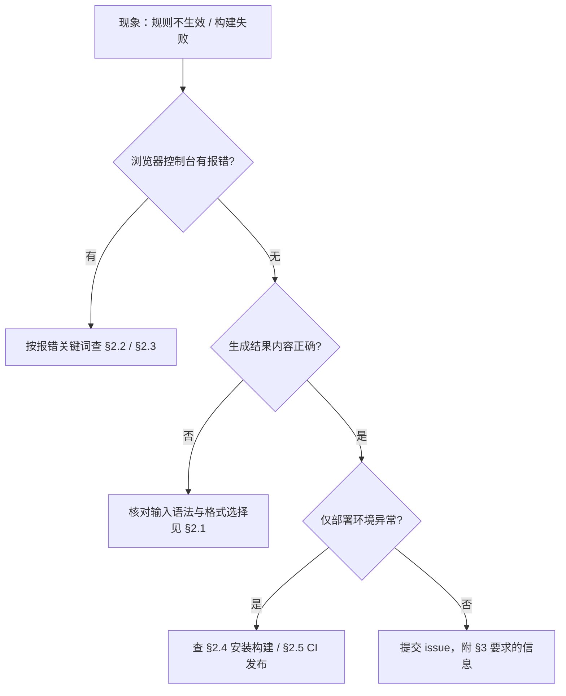

# 06 FAQ 与故障排除

> 最后审查：2026-11-27（与 package.json v3.22.5 对齐） · 文档集版本：v3.22.5
> 权威级别：权威说明 · 事实源：`src/config/seo-content.ts` 的 `FAQ_ITEMS`（页面可见文本 / JSON-LD / `llms.txt` 共用）；本文补充技术类问答。

## 目录

- [1. 常见问题（FAQ）](#1-常见问题faq)
- [2. 故障排除](#2-故障排除)
  - [2.1 规则导入路由器后不生效](#21-规则导入路由器后不生效)
  - [2.2 URL 导入失败](#22-url-导入失败)
  - [2.3 大清单解析慢或内存高](#23-大清单解析慢或内存高)
  - [2.4 本地安装 / 构建失败](#24-本地安装--构建失败)
  - [2.5 CI / 发布异常](#25-ci--发布异常)
  - [2.6 已知产品限制（非故障）](#26-已知产品限制非故障)
- [3. 仍未解决的问题](#3-仍未解决的问题)

## 1. 常见问题（FAQ）

### Q1：DNS Shield 会上传我的域名清单吗？

不会。域名解析、去重、排序与规则生成全部在浏览器本地完成（大文本由 Web Worker 并行处理），本站没有接收域名清单的服务端接口。只有主动点击「获取」时，浏览器才会抓取你自己填写的 URL。

### Q2：支持哪些路由器和 DNS 软件？

支持梅林固件、小米路由器、OpenWrt、AdGuard Home、Pi-hole、Unbound、SmartDNS、Mosdns、Clash Meta、CoreDNS 与 BIND RPZ，共 **12 种导出格式**：Dnsmasq、Hosts、AdGuard 黑名单、AdGuard 白名单、纯域名列表、Unbound、Pi-hole、BIND RPZ、SmartDNS、Mosdns、Clash Meta、CoreDNS。

### Q3：是否免费？源码在哪里？

完全免费、开源，采用 MIT 许可证。源码与更新日志托管在 GitHub（`github.com/sutchan/DNS_Shield`），也可以直接在本站生成规则后复制或下载，无需注册。

### Q4：如何输入白名单和自定义 DNS 改道？

每行一个域名；`#` 开头为注释，`+example.com` 表示白名单放行，`@example.com=192.168.1.1` 表示自定义 DNS 改道。也支持 hosts / dnsmasq / AdGuard 混合格式粘贴，以及 URL 批量导入。

### Q5：预生成的规则文件可以直接订阅吗？

可以。`/domains.txt` 是单一数据源，构建时由它生成 11 个格式的规则文件（如 `/dnsmasq.conf`、`/adguard.txt`、`/hosts.txt`、`/whitelist.txt`），可作为订阅 URL 或直接用脚本拉取。另有 `/category-index.txt` 提供域名分类索引，供界面分类筛选使用。

### Q6：离线时还能用吗？

生产环境会注册同源 Service Worker 缓存应用外壳与静态规则文件；首次联网加载成功后，断网可重新打开工具外壳。开发环境不注册 SW，避免 HMR 命中旧缓存。缓存仅覆盖同源 GET 与扩展名白名单资源，策略见 [SPEC §12.2](./SPEC.md#122-service-worker-安全)；注册实现见 [07 O-06](./07-improvements.md)。

### Q7：草稿会上传到服务器吗？

不会。草稿 30 秒自动保存到浏览器本地 IndexedDB（失败回退 localStorage），刷新后恢复且优先于远端预设清单；只有用户主动清空才会删除。本站没有接收清单的上传接口。

### Q8：支持多少语言？如何切换？

支持 16 种语言，简体中文为回退基准；顶栏「设置」→ 设置弹窗内选择语言与明暗主题，刷新后保持。阿拉伯语为 RTL，`<html lang>` / `dir` 首屏即同步。

### Q9：为什么页脚显示的构建编号每次部署都不同？

构建编号由 `next.config.js` 在构建期按 `yymmddhhmm`（2 位年）生成并注入 `NEXT_PUBLIC_BUILD_ID`，用于区分不同构建；版本号取自 `package.json`，仅在发版时变化。缺失构建编号时页脚回退显示版本号。格式规范见 [SPEC §8.1](./SPEC.md#81-页脚版本号与构建编号展示规范)。

---

## 2. 故障排除

排查顺序建议：**先看浏览器控制台与 toast → 再看生成结果 → 最后看部署 / CI**。

### 2.1 规则导入路由器后不生效

| 现象 | 可能原因 | 处理 |
|------|----------|------|
| 完全无拦截 | 文件格式与设备不匹配 | 对照 [05 用户指南 §3](./05-user-guide.md#3-首次使用下载并部署规则) 选择格式 |
| AdGuard Home 报规则非法 | 头部 usage 行未加注释符（旧版本产物） | 升级到 v3.15.0+ 产物；头部每行必须以 `#` / `!` / `;` 开头 |
| dnsmasq 启动失败 | 配置混入裸文本行 | 用 `head -n 20 dnsmasq.conf` 检查；重新下载最新产物 |
| 部分域名仍可访问 | 白名单放行或缓存未刷新 | 检查 `+` 行；清设备 DNS 缓存或重启服务 |
| hosts 文件超限 | 设备对 hosts 大小有限制 | 改用 dnsmasq / AdGuard 格式 |

### 2.2 URL 导入失败

- **提示「域名源加载失败」**：远端与同源 `domains.txt` 兜底均失败。检查网络、URL 是否为 http/https、长度 ≤2048；单响应上限 10MB、每批上限 50MB / 5 个 URL。
- **部分 URL 成功、部分失败**：仍视为成功，失败项需单独核对；toast 会给出失败提示。
- **跨域失败**：目标服务器未开放 CORS 时浏览器会拒绝读取；可先手动下载后粘贴。

### 2.3 大清单解析慢或内存高

- 阈值：<5000 行主线程，5000–19999 行单 Worker，≥20000 行最多 8 个 Worker 分片。
- 若浏览器内存占用高：减少单次输入规模、关闭不必要的浏览器标签；已知优化点（全量 `split`、分片复制）见 [07 优化建议](./07-improvements.md) O-01/O-02。
- 不要反复点击「生成规则」：解析任务已单飞，但重复输入会触发新的解析。

### 2.4 本地安装 / 构建失败

| 报错 | 原因 | 处理 |
|------|------|------|
| `engine-strict` / Node 版本不匹配 | 要求 `>=24.15.0 <25`、npm ≥11 | 切换 Node 24.15+ / npm 11；`.npmrc` 已启用 `engine-strict=true`，不满足约束会在安装期直接失败（见 [07 O-05](./07-improvements.md)） |
| `npm ci` 失败 | 锁文件与 `package.json` 不一致 | 先本地 `npm install` 更新并提交 `package-lock.json` |
| `next build` 取字体失败 | 使用 `next/font/google` 的外部字体 | 本项目已统一系统字体栈，不应出现；若出现请检查是否误引入外部字体依赖 |
| `vitest --coverage` 清理 `coverage/` 卡死 | IDE safe-delete shim 超时（环境限制） | 改用 `--coverage.reportsDirectory=.tmp/coverage`；CI 不受影响 |
| 根目录清洁度门禁失败 | 临时脚本 / 日志 / 缓存散落在根目录或 `scripts/` | 按类型移入 `.tmp/scripts/`、`.tmp/logs/`、`.tmp/cache/`（详见 [TEMP-FILES.md](./TEMP-FILES.md)）；`npm run tmp:clean` 可一键清理 |
| `.tmp/` 目录不存在 | 未被自动创建 | 执行 `npm run tmp:init`（幂等），或运行门禁时会自动初始化 |

### 2.5 CI / 发布异常

- **CI 红在 setup**：检查 `package-lock.json` 是否入库、`setup` 复合动作缓存是否命中；Node 须满足 `>=24.15.0 <25`、npm `>=11`（`.npmrc` 已启用 `engine-strict=true`）。
- **Release 未生成**：Release 工作流由 Deploy 成功后触发，须确认 `main` 的 CI → Deploy 全绿且事件链为同仓库 `push`。历史上远端 tag 与 `package.json` 脱节的问题已闭环：v3.22.4 tag 与 Release（14 资产）已生成，取证见 [tasks-done T-CI-01](./tasks-done.md)。
- **规则文件未更新**：改动 `public/domains.txt`（源数据）后必须运行 `npm run build:formats` 并提交 11 个派生规则文件（`dnsmasq.conf`、`hosts.txt`、`adguard.txt`、`whitelist.txt`、`unbound.conf`、`pihole.txt`、`smartdns.conf`、`mosdns_domain_set.txt`、`clash_dns.yaml`、`coredns_hosts.txt`、`rpz.db`；清单以 `node scripts/gen-format-files.mjs --list-files` 为准）。`category-index.txt` 由 `scripts/aggregate-upstream.mjs` 单独生成，不在这 11 项内，但同样必须入库并发布。

### 2.6 已知产品限制（非故障）

| 项 | 当前事实 | 依据 |
|----|----------|------|
| PWA 离线缓存 | 生产环境由 `ServiceWorkerRegistrar` 注册（dev 跳过），缓存范围见 SPEC §12.2 | [07 O-06](./07-improvements.md) / [tasks-done T-PWA-01](./tasks-done.md) |
| `category-index.txt` | 已纳入 aggregate / release / CI 清单，线上 404 风险已消除 | [tasks-done T-REL-01](./tasks-done.md) |
| 生产 CSP | `script-src` 含 `'unsafe-inline'`（首屏脚本所需）；Trusted Types 评估结论为暂不启用 | [CSP 评估](./05-security-assessment-csp.md) / [tasks-done T-SEC-01](./tasks-done.md) |
| 部分设备对 hosts 文件大小有限制 | 产品限制，建议改用 dnsmasq / AdGuard 格式 | [SPEC §6.2](./SPEC.md#62-规则文件导入无原生一键脚本) |
| `AppProvider value` | 已用 `useMemo` 稳定，消费者不再全量重渲染 | [tasks-done.md](./tasks-done.md) |
| Node / npm 约束 | `.npmrc` 已启用 `engine-strict=true`；Node ≥24.15.0 / npm ≥11 已完成实机验证 | [tasks-done T-COMPAT-01](./tasks-done.md) |
| 域名计数 | `public/domains.txt` 当前 127188 条（从 `af976b8` 恢复后实算）；旧值 644 已失效，以 `node scripts/count-domains.mjs` 为准 | [tasks.md](./tasks.md) 实时指标 |
| 测试规模 | 实测 61 套件 / 381 用例全绿（2026-11-26 `npm test`） | [tasks.md](./tasks.md) 实时指标 |

## 3. 仍未解决的问题

任何本文未覆盖、或按上述步骤仍无法解决的问题，请附以下信息提交 issue：

1. 使用路径（直接下载 / 自定义清单 / URL 导入）与目标设备型号；
2. 浏览器与版本、是否开启深色 / RTL；
3. 控制台报错与 toast 文案；
4. 复现步骤与期望结果。

如发现新问题，按 [SPEC §5.3](./SPEC.md#53-任务记录规范强制) 先登记到 [任务清单](./tasks.md)，本文只保留诊断证据与恢复方法，不维护任务状态。
